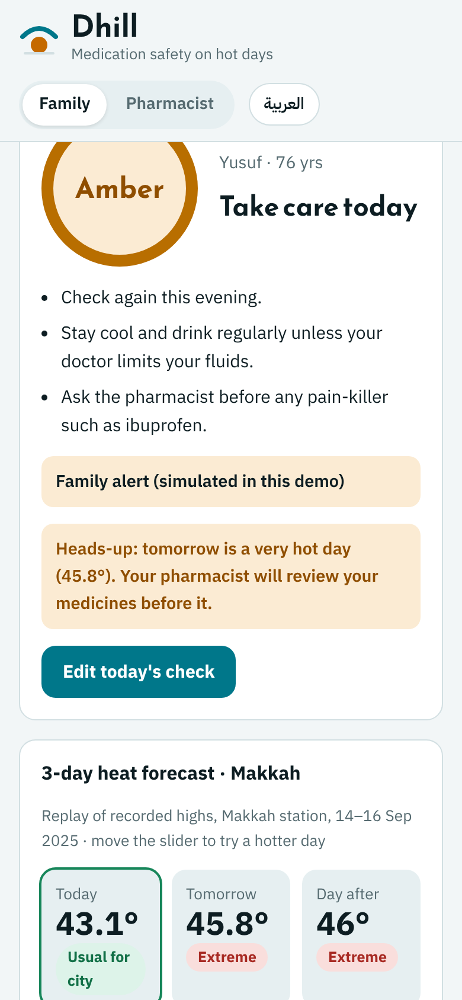
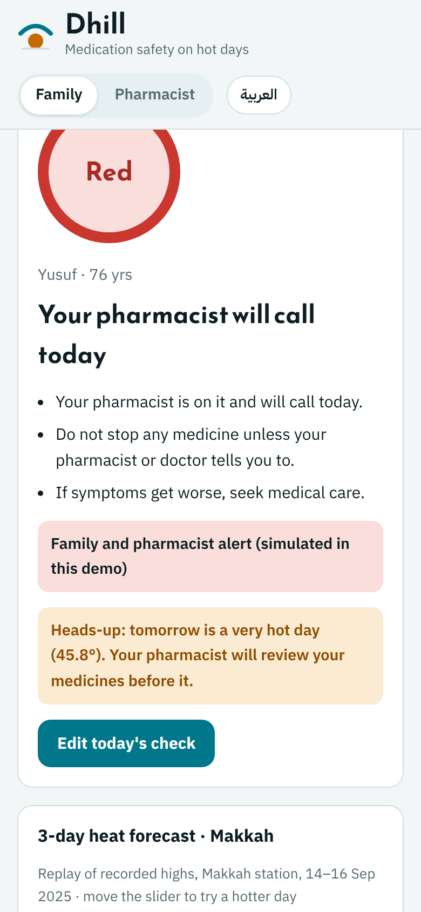
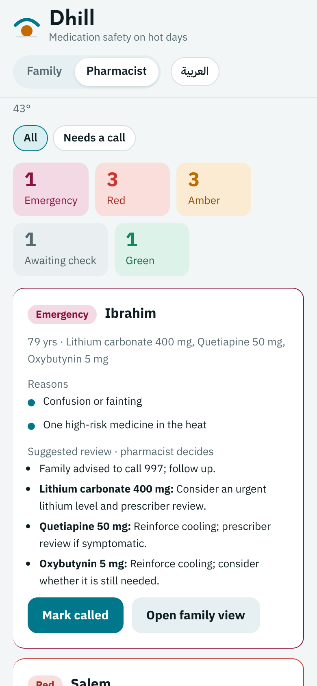

# Dhill · ظِلّ — medication safety for older adults on hot days

MEDATHON 2026 · Team **Dhill Team** · code **MED-7DPNRE** · Track 4 (out-of-hospital care)

**Live MVP:** https://dhill.pages.dev (version 1.3, 3 Nov 2026; Arabic and English; fictional patients only)

**Demo video (78 s):** https://dhill.pages.dev/media/dhill-demo-v1.3.mp4. The same file is also in [`media/`](media/).

| Day before: heads-up | Very hot day: red | Pharmacist call list |
|---|---|---|
|  |  |  |

Dhill combines three things that existing tools keep apart:

1. **The patient's own medicine list.** Each medicine gets a heat-risk tag (27 drug classes, from CDC Heat & Medications guidance and the sick-day consensus of Watson et al. 2023).
2. **The city's heat forecast.** The live 3-day forecast (Open-Meteo) is compared with that city's own summer: each city's 90th, 95th and 97.5th percentiles of daily maximum temperature, 2021–2025. When a very hot day is coming, a heads-up goes out the day before.
3. **A one-minute home check.** Weight against usual weight, dizziness, fluids, vomiting or diarrhoea, fever and confusion, plus blood pressure and pulse if a cuff is available.

The result is one colour a day:

- **Green** — a routine day.
- **Amber** — a family reminder and an evening re-check.
- **Red** — the patient goes on the pharmacist's call list.
- **Emergency** — call 997.

The app never stops a medicine. Every medicine decision stays with the pharmacist or doctor.

> Demo for judging only. **Not for clinical use.** All patients are fictional. No real patient data is used anywhere in this repository.

## Try it in 1 minute

1. Open https://dhill.pages.dev. The **English** button is at the top.
2. Yusuf (furosemide + valsartan) is shown with today's live forecast for Makkah.
3. Press **Replay a real recorded heat spell**. This replays the recorded highs at the Makkah station on 14–16 Sep 2025:
   - today becomes **amber**;
   - a **heads-up** says tomorrow is a very hot day.
4. Move the **High today** slider to 46°. On the city's hottest 5% of days, high-risk medicines put the patient on the pharmacist's list (**red**), even with no symptoms.
5. Switch to **Pharmacist** to see the ranked call list. It shows the pre-heat review tags and the one-off review of a dangerous medicine mix.

## What is in this repository

| File | What it is |
|---|---|
| `index.html` | The whole app, one file: HTML, CSS and JavaScript. It is the same file deployed at dhill.pages.dev. |
| `engine_v13.js` | Rule engine v1.3. It is identical to the engine inside `index.html`: 1,296 status-and-reason comparisons, 0 differences. |
| `patients.js` | The 9 fictional demo patients. |
| `invariants_v13.js` | Test 1. It runs every medicine list of up to 3 drugs × every temperature from 30 to 50 °C × every home-check answer. Each result is checked against 9 safety rules written before the run. |
| `results_v1.3_invariants_*.json` | Test 1 results: 4 cities × 278,077,514 engine calls = **1.11 billion, 0 violations**. |
| `heat_analysis.py`, `make_series.py` | Test 3 (5 years of real weather). These scripts read Meteostat daily station files: WMO 41030, 41024, 40438 and 40430. The weather data themselves are not redistributed. |
| `results_heat_days_per_year.json`, `results_heat_out_of_sample.json` | High-risk days per year under one fixed 43 °C cut-off and under city thresholds, plus the out-of-sample check. |
| `load13.js`, `results_v1.3_alert_load.json` | Alert load of v1.3 on 2021–2025 weather for symptom-free patients (results below). |
| `vignettes.js`, `rescore.js` | Test 5. `vignettes.js` rebuilds the 50 fictional test cases from a fixed seed; `rescore.js` re-scores them with any engine version. |
| `results_pharmacist_agreement_summary.json` | Agreement with the blind pharmacist rating, as counts only (table below). Case-level ratings are not published. |
| `results_v1.3_accessibility_local.json` | Test 4: axe-core 4.10, WCAG 2.1 AA, on Arabic/English, light/dark and phone/desktop. |
| `media/` | Six screens of v1.3 and the 78-second demo video. |

### Alert load of v1.3 (2021–2025 weather, patient with no symptoms)

| Medicines | Red days a year (pharmacist call) | Amber days a year (family reminder only) |
|---|---|---|
| 2 high-risk medicines | 19–21 | 90–170 |
| 1 heat-sensitive medicine | 0 | 109–191 |
| Low-risk medicines only | 0 | 0 |

### Agreement with the blind pharmacist rating (50 fictional cases)

| | v1.1 (blind) | v1.2 | v1.3 |
|---|---|---|---|
| Same colour as the pharmacist | 20/50 | 44/50 | 45/50 |
| Weighted kappa (linear) | 0.34 | 0.83 | 0.85 |
| His red or emergency cases rated only green or amber | 20 of 34 | 4 of 34 | 0 of 34 |
| His emergencies rated only red | 2 of 5 | 1 of 5 | 1 of 5 |
| More cautious than the pharmacist | 0 | 1 | 4 |

v1.2 and v1.3 were written after seeing these ratings, so their scores are **not a validation**. The next step is new cases rated blind by more pharmacists.

## Run the tests

```bash
node invariants_v13.js makkah 3       # also: jeddah, riyadh, madinah. About 5 minutes per city.
node rescore.js ./engine_v13.js       # the app's colour for each of the 50 cases
python3 make_series.py && node load13.js   # needs the Meteostat files m_<station>.csv.gz in this folder
```

## Not built yet

- Barcode scan and e-prescription import.
- Real SMS or app alerts to the family and the pharmacist. Alerts are simulated in the demo.
- Accounts and secure data storage.
- Escalation when a red is not called back.

© 2026 Dhill Team (Umm Al-Qura University). Shared for MEDATHON 2026 judging. Not licensed for reuse or clinical use.
